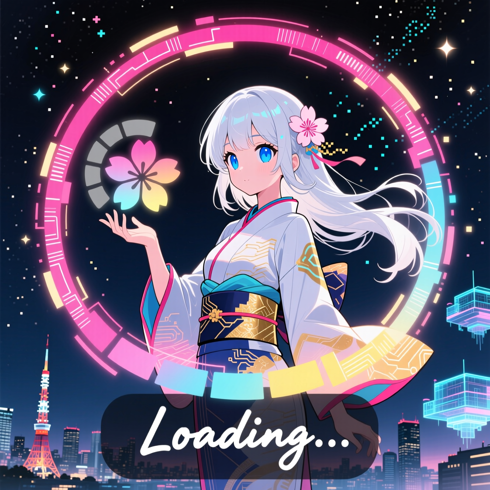

<div align="center">


<!-- npm V10.9.0 -->
[](https://www.npmjs.com)
[](https://bun.sh)
[](https://vitejs.dev)
[](https://nodejs.org)
[](https://github.com/MakotoArai-CN/lazy-pic/blob/main/LICENSE)
<!-- start-badges -->
[](https://github.com/MakotoArai-CN/lazy-pic/stargazers)
[](https://github.com/MakotoArai-CN/lazy-pic/network)
[](https://github.com/MakotoArai-CN/lazy-pic/watchers)
[](https://github.com/MakotoArai-CN/lazy-pic/issues)

</div>

> 🖼️ エレガントなプログレッシブ画像ローディングライブラリ（TypeScript対応）

<p align="center">
<pre>
        ██╗      █████╗ ███████╗██╗   ██╗     ██████╗ ██╗ ██████╗
        ██║     ██╔══██╗╚══███╔╝╚██╗ ██╔╝     ██╔══██╗██║██╔════╝
        ██║     ███████║  ███╔╝  ╚████╔╝█████╗██████╔╝██║██║
        ██║     ██╔══██║ ███╔╝    ╚██╔╝ ╚════╝██╔═══╝ ██║██║
        ███████╗██║  ██║███████╗   ██║        ██║     ██║╚██████╗
        ╚══════╝╚═╝  ╚═╝╚══════╝   ╚═╝        ╚═╝     ╚═╝ ╚═════╝
</pre>

</p>

<p align="center">

[[English](../README.md) | [中文](./README-ZH.md) | [日本語](./README-JP.md) ]

</p>

## ✨ 特徴

- 🚀 **並行ロード**: ビューポートに入った画像が、前の画像のアニメーション完了を待たずに同時に読み込まれます
- ⚡ **コンポジター向けモーション**: トランジションは Web Animations API ベースで、毎フレームの style 書き込みを行いません
- 🖼️ **デコード後に表示**: 画像をプリロードしてデコードしてからフェードインするため、遷移中のデコード落ちがありません
- 🎨 **上品なトランジション**: 9種類、デフォルト600ms
- 📱 **レスポンシブ**: すべてのデバイスサイズに最適
- 🎯 **ストラテジーパターン**: 異なるユースケースに対応する3つのロード戦略
- 🔧 **柔軟な設定**: 適切なデフォルト値（`600ms`、`rootMargin: 200px`、`threshold: 0.01`）
- ♿ **視差効果の低減**: `prefers-reduced-motion` に自動対応
- 📦 **小型・ゼロ依存**: UMD 約34.3KB、gzip 約8.6KB
- 🌍 **ブラウザサポート**: IntersectionObserver 対応の現代ブラウザ（未対応時は全件ロードにフォールバック）
- ⚡ **最適化されたトランジション**: 滑らかでエレガントなプログレッシブローディング効果

## 📦 インストール

### NPM
```bash
npm install @makotoarai/lazy-pic
```

### Bun
```bash
bun add @makotoarai/lazy-pic
```

### CDN
```html
<script src="https://unpkg.com/@makotoarai/lazy-pic@0.6.0/dist/lazy-pic.umd.js"></script>
```

### ブラウザ

1. リポジトリをクローン: `git clone https://github.com/MakotoArai-CN/lazy-pic.git` または最新リリースをダウンロード。

1. HTMLに `dist/lazy-pic.umd.js` ファイルを含める:

  ```html
  <script src="path/to/lazy-pic.umd.js"></script>
  ```

1. ブラウザでは UMD グローバルを使って初期化します:

  ```html
  <script>
    const lazyPic = new LazyPic.LazyPic({
      selector: '.lazy-image',
      strategy: 'data-src'
    });
    lazyPic.init();
  </script>
  ```

## 🚀 クイックスタート

### ESモジュール

```javascript
import { LazyPic } from '@makotoarai/lazy-pic';

const lazyPic = new LazyPic({
  selector: '.lazy-image',
  strategy: 'data-src',
  animationType: 'fade',
  animationDuration: 600
});

lazyPic.init();
```

デフォルト値は体感速度を優先して調整されています。画像はビューポートに入る200px手前から読み込みを開始し、トランジションは600ms、人為的な待ち時間はありません。

## 🌐 サンプル

- [サンプル一覧](../examples/index.html)
- [Vanilla JavaScript デモ](../examples/vanilla.html)
- [Vue CDN デモ](../examples/vue.html)
- [React CDN デモ](../examples/react.html)
- [Alpine CDN デモ](../examples/alpine.html)

すべてのブラウザ向けサンプルは `dist/lazy-pic.umd.js` を読み込みます。開く前に `bun run build` を実行してください。

## 📖 使用例

### 1. デュアルイメージ戦略 (推奨)

フル解像度画像には `data-src` を使ってください。`src` に書くと HTML 解析時点でブラウザが取得を開始し、LazyPic では遅延できません。

```html
<div style="position: relative">
  
  
</div>
```

```javascript
const lazyPic = new LazyPic({
  selector: '.main-image',
  strategy: 'dual-image',
  animationType: 'fade', // fade, slide, scale, zoom, rotate, blur, flip, reveal, spiral
  animationDuration: 600,
  easing: 'ease-out' // linear, ease, ease-in, ease-out, ease-in-out, bounce, elastic
});
lazyPic.init();
```

画像が既にキャッシュ済み、または `init()` 前に読み込み済みの場合は、アニメーションをスキップして即座に表示します。

### 2. Data-src 戦略

```html

```

```javascript
const lazyPic = new LazyPic({
  selector: '.lazy-image',
  strategy: 'data-src',
  enableBlur: true,
  blurIntensity: 10,
  animationType: 'slide'
});
lazyPic.init();
```

高解像度画像をプリロード・デコードしてから、絶対配置のオーバーレイでクロスフェードします。オーバーレイが完全に表示されてから実際の `src` を差し替えるため、ちらつきも二度目の通信待ちもありません。

### 3. アニメーション戦略

```html
<div>
  
</div>
```

```javascript
const lazyPic = new LazyPic({
  selector: '.animated-image',
  strategy: 'animation',
  placeholder: {
    animation: 'skeleton', // 下記の厳選ローダーを参照
    color: '#007bff',
    width: '100%',
    height: '300px',
    showText: true,
    loadingText: 'Loading beautiful image...'
  }
});
lazyPic.init();
```

プレースホルダーは100ms以内に画像が準備できない場合のみ表示されます。キャッシュ済み画像でスケルトンが一瞬ちらつくことはなく、最短表示時間による待ちもありません。

## ⚙️ 設定

```typescript
interface LazyPicConfig {
  selector: string;                    // ターゲット要素セレクター
  animationDuration?: number;          // トランジション時間（デフォルト600ms、120–2000msに制限）
  strategy?: 'dual-image' | 'data-src' | 'animation';
  enableBlur?: boolean;                // 低解像度プレースホルダーのぼかし（デフォルトtrue）
  blurIntensity?: number;              // ぼかし強度（px、デフォルト8）
  animationType?: 'fade' | 'slide' | 'zoom' | 'scale' | 'rotate' | 'blur' | 'flip' | 'reveal' | 'spiral';
  easing?: 'linear' | 'ease' | 'ease-in' | 'ease-out' | 'ease-in-out' | 'bounce' | 'elastic';
  rootMargin?: string;                 // IntersectionObserver ルートマージン（デフォルト200px）
  threshold?: number | number[];       // IntersectionObserver 閾値（デフォルト0.01）
  placeholder?: PlaceholderConfig;     // プレースホルダー設定
  completionEffect?: CompletionEffectConfig; // 任意の完了エフェクト（デフォルトOFF、onLoadをブロックしません）
  quality?: QualityConfig;             // 非推奨：実行時には未適用
  onError?: (error: Error, element: Element) => void;
  onLoad?: (element: Element) => void; // 画像が表示された直後に発火
  onStartLoad?: (element: Element) => void;
  onProgress?: (progress: number, element: Element) => void; // 非推奨：未実装
}
```

> `progressive`、`mosaic`、高度な `performance` 設定、`loadAll()` は現在の実行時 API に含まれません。
> `placeholder.customContent` と `mask.customContent` の文字列はプレーンテキストとして扱われ、HTML として注入されません。
> `prefers-reduced-motion` が有効な場合はトランジションを自動的にスキップします。

## 🎨 アニメーションタイプ

- **fade**: スケール変化なしの純粋な透明度クロスフェード
- **slide**: 短い上方向スライド + フェード
- **zoom/scale**: `1.05`/`0.94` からのスケール収束
- **rotate**: 軽い回転 + スケール
- **blur**: ぼかしからシャープへ
- **flip**: 控えめなパースペクティブフリップ
- **reveal**: 円形 / カーテン状の clip-path リビール
- **spiral**: 軽い回転を伴う clip-path リビール

トランジションは WAAPI のキーフレーム（`opacity`、`transform`、`filter`、`clip-path`）で実行されます。長すぎる指定は2秒に制限されます。

## 🎭 プレースホルダーアニメーション

10個のコンパクトな CSS ローダーを内蔵し、1つのスタイルシートと `--lp-color` / `--lp-speed` カスタムプロパティを共有します：

`skeleton`、`shimmer`、`spinner`、`dots`、`pulse`、`wave`、`progress-bar`、`grid`、`scanner`、`orbit`。

旧名称も使用可能で、最も近いローダーにマッピングされます：`skeleton-lines` → `skeleton`、`diagonal-shimmer` / `shine` → `shimmer`、`breathing` / `ripple` / `particles` / `pulse-ring` → `pulse`、`typing` / `wave-dots` → `dots`、`arc` → `spinner`、`bars` / `equalizer` / `ladder` / `flow` / `blink` → `wave`、`cube` / `radar` → `orbit`、未知の値 → `skeleton`。

低コストな推奨：`skeleton`、`shimmer`、`spinner`、`progress-bar`、`dots`。

## 🔧 APIメソッド

- `init()`: 遅延ロードを初期化
- `destroy()`: クリーンアップ、進行中の処理を無効化し、オブザーバーを削除
- `updateConfig(config)`: 設定を更新して再スキャン
- `loadImage(element)`: 手動で画像ロードをトリガー
- `refresh()`: 新しい要素を再スキャンして観察
- `getStatus()`: 現在の状態を取得

## 📈 パフォーマンスヒント

1. フル解像度画像は `src` ではなく `data-src` を使用（`src` は解析時に取得が始まります）。
2. `rootMargin` は200px以上を維持し、プリロードに余裕を持たせる。
3. サムネイルは5KB未満を推奨。大きな画像で長時間の `filter` アニメーションは避ける。
4. 必要がない限り `completionEffect` はOFFのまま。
5. サムネイルがある場合は `dual-image`、単一のプログレッシブ画像は `data-src` を使用。サムネイルはフル画像の上に絶対配置すると、非表示時にレイアウトへ影響しません。
6. `prefers-reduced-motion` は自動で尊重されます。
7. 最も落ち着いた完了には `animationType: 'fade'` + `easing: 'ease-out'` を使用してください。`bounce` イージングと `completionEffect.type: 'bounce'` は意図的にオーバーシュートします。

## 📦 バンドルサイズ

`bun run build` の実測：UMD は 51.5KB（gzip 11.1KB）から約34.3KB（gzip 約8.6KB）へ、ESM は明示的に圧縮され約34.0KB（gzip 約8.4KB）です。

## 🔧 ビルドと開発

```bash
# 依存関係をインストール
bun install

# 開発
bun run dev

# ビルド
bun run build

# プレビュー
bun run preview

# テスト
bun run test
```

## 変更履歴

### 0.6.0

- トランジションを Web Animations API に移行。毎フレームの `requestAnimationFrame` スタイル書き込みと transform 文字列の再解析を廃止
- ビューポートに入った画像を並行ロードし、前の画像のアニメーション完了を待たないように変更
- 画像をプリロードしてデコードしてから表示し、遷移中のデコード落ちを排除
- 固定800msのプレースホルダー表示を廃止。100ms後にのみ表示し、画像のフェードインと同時にフェードアウト
- `dual-image` で `data-src` をサポートし、キャッシュ済み画像の高速パスを追加
- 完了エフェクトを非ブロッキング化し、`onLoad` を遅延させない
- 27個のインラインスタイルローダーを、10個のコンパクトな CSS ローダー + 互換エイリアスに置き換え
- `unobserve` 時にロード開始直後のクリーンアップが走る不具合を修正
- `destroy()` / `refresh()` で古い非同期処理を無効化
- `prefers-reduced-motion` に対応。トランジション時間は120–2000msに制限
- 新しいデフォルト値：`animationDuration: 600`、`rootMargin: 200px`、`threshold: 0.01`
- ESM 出力を圧縮（Vite のライブラリビルドは ES の terser をスキップ）。UMD は 51.5KB → 約34.3KB（gzip 11.1KB → 約8.6KB）
- 完了時に「跳ね返る」ように見える2つの原因を修正：フロー内のサムネイルは `display:none` ではなく `visibility` で非表示にし（レイアウトジャンプなし）、`data-src` はプレースホルダーのぼかし解除中に CSS transition をロックするため、クロスフェード後に余分な「鮮明化」トランジションが走りません
- `animationType: 'fade'` は純粋な透明度クロスフェードになりました。スケール変化は `zoom`/`scale` を明示した場合のみです
- Vitest 設定を追加し、並行ディスパッチ、オブザーバーライフサイクル、クリーンアップ、ローダーエイリアスのテストを追加

### 0.5.0

- ローカル開発コマンドを Bun に統一し、不要な Vitest ラッパーと設定ファイルを削除
- サンプルを Vanilla JavaScript、Vue、React、Alpine の独立した CDN ページへ分割
- ブラウザ / CDN ドキュメントを `dist/lazy-pic.umd.js` と UMD グローバル API に合わせて更新

### 0.4.0-beta

- より良い型チェックとコード品質のためにTypeScriptを使用
- 設定とAPIメソッドの型定義を追加
- プレースホルダーと品質設定の型定義を追加
- 不要な依存関係を削除
- npm、bun、CDNの公開を追加

### 0.3.0-beta

- アニメーション(anime)遅延ロードモードを追加。
- 遅延ロードモードを最適化。
- バージョン番号の内容を変更。
- 今後のバージョン更新予定：
  1. 遅延ロード判定ロジックを最適化し、コードを削減。
  2. (可能性あり)既知のアニメーション遅延ロードモードのバグを修正。

### 0.2.1-beta

- 遅延ロード判定ロジックによる表示遅延を修正。

### 0.2.0-beta

- ネットワーク速度が遅いことによる遅延ロードモードを最適化。
- ネイティブJavaScriptモードの一部のバグを修正。
- 今後のバージョン更新予定：
  1. アニメーション遅延ロードモードを追加。
  2. より多くのオプションパラメータ設定を追加。

### 0.1.0-beta

- data-src遅延ロードモードを追加。
- 任意のページで使用できる純粋なJavaScriptバージョンを追加。
- ガウスぼかしを追加。
- 今後のバージョン更新予定：
  1. サムネイルのプログレッシブロードをさらに追加。
  2. 純粋なJavaScriptバージョンを追加。

### 0.0.1-beta

- ベータ版のみで、機能が不完全。
- 今後のバージョン更新予定：
  1. サムネイルのプログレッシブロードをさらに追加。
  2. 純粋なJavaScriptバージョンを追加。

## 📄 ライセンス

Apache-2.0 ライセンス

## 🤝 コントリビューション

コントリビューションを歓迎します！プルリクエストを気軽に送信してください。